# Post-contenido — Unidad 7: Patrones Arquitectónicos I

## Descripción

Repositorio del post-contenido de la Unidad 7 de Patrones de Diseño de Software. Contiene un único
proyecto Spring Boot, `multas-biblioteca-api`, para la gestión de multas de una biblioteca
universitaria: la biblioteca registra una multa cuando un estudiante devuelve un libro con retraso,
el sistema calcula su monto y permite marcarla como pagada. El trabajo tiene dos partes:

- **Parte 1:** API REST con arquitectura en capas (Model, Repository, Service, Controller) sobre H2.
- **Parte 2:** pago en línea de multas con dos pasarelas intercambiables (PagosUDES y Wompi),
  resuelto con un puerto de dominio y dos adaptadores aplicados solo a la porción de pago.

## Parte 1 — Arquitectura en Capas

Cada capa vive en su propio paquete y solo depende de la capa inmediatamente inferior: el
controlador nunca accede al repositorio, siempre pasa por `MultaService`.

| Capa | Paquete | Clases | Responsabilidad |
|---|---|---|---|
| Presentación | `controller/` | `MultaController`, `GenerarMultaRequest`, `GlobalExceptionHandler` | Recibe HTTP, valida la entrada con Bean Validation y traduce excepciones a 400, 402, 404 y 409. No contiene reglas de negocio. |
| Aplicación | `service/` | `MultaService` | Orquesta los casos de uso, aplica el tope de 3 multas pendientes y delimita las transacciones con `@Transactional`. |
| Dominio | `model/` | `Multa`, `EstadoMulta`, excepciones de negocio | Entidad con comportamiento propio: `calcularMonto` (días × $500, tope $15.000) y `marcarComoPagada`. |
| Infraestructura | `repository/` | `MultaRepository` | Acceso a datos con Spring Data JPA, incluida la consulta agregada `countByEstudianteIdAndEstado`. |

`MultaService` no es un *passthrough* del repositorio: decide si un estudiante puede recibir otra
multa, delega en la entidad el cálculo del monto y el cambio de estado, y en la Parte 2 orquesta el
pago con la pasarela activa.

## Parte 2 — Pago en Línea con Dos Pasarelas

**Opción elegida: C — puerto de dominio con dos adaptadores, aplicado solo a la porción de pago.**
El resto del proyecto (`Multa`, `MultaRepository`, `MultaController`) se mantiene en capas: migrarlo
todo a hexagonal sería sobre-ingeniería para este alcance.

- `domain/port/PasarelaPagoPort` define lo que el dominio necesita: `ResultadoPago procesar(Multa multa)`.
- `domain/ResultadoPago` y `domain/PagoRechazadoException` son Java puro, sin ningún import de Spring
  ni de clientes HTTP.
- `infrastructure/pago/PagosUdesAdapter` envía el monto en pesos y traduce
  `idTransaccion`/`estadoTransaccion`; `infrastructure/pago/WompiAdapter` envía el monto en centavos y
  traduce `reference`/`status`. Ambos devuelven el mismo `ResultadoPago`.
- La pasarela activa se elige con `app.pagos.proveedor` (`pagosudes` o `wompi`) mediante
  `@ConditionalOnProperty`, sin tocar `MultaController` ni `MultaService`.
- `MultaService.pagarConPasarela` depende solo del puerto y se expone en `POST /api/multas/{id}/pagar-en-linea`.
  Un pago rechazado responde **402 Payment Required**; una multa ya pagada, **409 Conflict**.

Comparación de las opciones evaluadas:

| Opción | Qué implica | Por qué se descartó o se eligió |
|---|---|---|
| A. Rama condicional en `MultaService` | Un `if/switch` que llama a un cliente HTTP distinto según la configuración | Descartada: `MultaService` conocería los formatos HTTP de ambas pasarelas y habría que modificarlo para agregar o quitar una. |
| B. Strategy dentro de `service/` | Interfaz `PasarelaPago` con dos `@Service` | Descartada: resuelve la intercambiabilidad, pero la traducción de formatos externos queda en la capa de aplicación y la interfaz vive junto al servicio que la usa. |
| **C. Puerto de dominio + adaptadores** | `PasarelaPagoPort` en `domain/`, adaptadores en `infrastructure/` | **Elegida:** cada pasarela tiene un contrato HTTP distinto y el número de proveedores puede cambiar al terminar el piloto. |

Para probar sin pasarelas reales, el proyecto incluye `infrastructure/simulador/PasarelasSimuladasController`,
que imita el contrato HTTP de ambos proveedores. Solo se carga con el perfil `simulador` y aprueba los
pagos de hasta $10.000, rechazando los mayores, para poder demostrar ambos casos.

### Estructura de paquetes final

```
gamboa-post1-u7/
├── README.md
├── docs/capturas/                          ← evidencia de los endpoints probados
└── multas-biblioteca-api/
    ├── pom.xml
    └── src/main/
        ├── resources/
        │   ├── application.properties              ← app.pagos.proveedor
        │   └── application-simulador.properties    ← URLs del simulador
        └── java/com/example/multas/
            ├── MultasBibliotecaApiApplication.java
            ├── controller/          (Parte 1 + endpoint /pagar-en-linea y manejo del 402)
            │   ├── MultaController.java
            │   ├── GenerarMultaRequest.java
            │   └── GlobalExceptionHandler.java
            ├── service/             (Parte 1 + dependencia de PasarelaPagoPort)
            │   └── MultaService.java
            ├── model/               (Parte 1 — sin cambios)
            │   ├── Multa.java
            │   ├── EstadoMulta.java
            │   ├── MultaNotFoundException.java
            │   ├── LimiteMultasPendientesException.java
            │   └── MultaYaPagadaException.java
            ├── repository/          (Parte 1 — sin cambios)
            │   └── MultaRepository.java
            ├── domain/              ← NUEVO: puerto y modelo de resultado, sin Spring
            │   ├── port/
            │   │   └── PasarelaPagoPort.java
            │   ├── ResultadoPago.java
            │   └── PagoRechazadoException.java
            └── infrastructure/      ← NUEVO: adaptadores, conocen Spring y HTTP
                ├── pago/
                │   ├── PagosUdesAdapter.java
                │   └── WompiAdapter.java
                ├── config/
                │   └── RestTemplateConfig.java
                └── simulador/
                    └── PasarelasSimuladasController.java   (solo perfil "simulador")
```

Dirección de las dependencias en la porción de pago:

```
MultaController ──► MultaService ──► PasarelaPagoPort ◄── PagosUdesAdapter ──► PagosUDES (HTTP)
                                     (domain/)        ◄── WompiAdapter     ──► Wompi (HTTP)
```

### Endpoints

| Método | Ruta | Descripción | Respuestas |
|---|---|---|---|
| GET | `/api/multas` | Lista todas las multas | 200 |
| GET | `/api/multas/{id}` | Busca una multa por ID | 200, 404 |
| GET | `/api/multas/estudiante/{estudianteId}` | Lista las multas de un estudiante | 200 |
| POST | `/api/multas` | Genera una multa y calcula su monto | 201, 400, 409 |
| PATCH | `/api/multas/{id}/pagar` | Paga una multa en ventanilla | 200, 404, 409 |
| POST | `/api/multas/{id}/pagar-en-linea` | Paga una multa con la pasarela activa | 200, 402, 404, 409 |

## Cómo ejecutar

Requisitos: Java 17 o superior y Maven 3.8+ (o el wrapper `./mvnw` incluido).

```bash
cd multas-biblioteca-api
mvn clean package && mvn spring-boot:run
```

La API queda en `http://localhost:8080/api/multas` y la consola H2 en
`http://localhost:8080/h2-console` (JDBC URL `jdbc:h2:mem:multas_biblioteca_db`, usuario `sa`, sin contraseña).

Para probar el pago en línea con el simulador de pasarelas, y cambiar de proveedor solo por
configuración, sin recompilar:

```bash
# PagosUDES (proveedor por defecto)
java -jar target/multas-biblioteca-api-0.0.1-SNAPSHOT.jar --spring.profiles.active=simulador

# Wompi: mismo JAR, solo cambia la propiedad
java -jar target/multas-biblioteca-api-0.0.1-SNAPSHOT.jar --spring.profiles.active=simulador --app.pagos.proveedor=wompi
```

También puede cambiarse `app.pagos.proveedor` directamente en `application.properties`.

Ejemplo:

```bash
curl -i -X POST http://localhost:8080/api/multas \
  -H "Content-Type: application/json" \
  -d '{"estudianteId":"EST-001","concepto":"Devolucion tardia de Clean Code","diasAtraso":5}'
curl -i -X POST http://localhost:8080/api/multas/1/pagar-en-linea
```

## Evidencia de pruebas

### Parte 1

**1. Lista vacía al iniciar — 200 OK**  
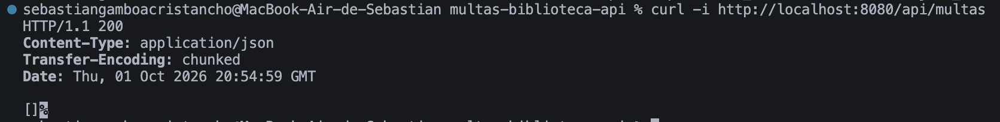

**2. Creación de una multa con monto calculado (5 días × $500 = $2.500) — 201 Created**  
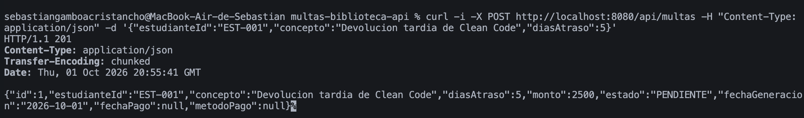

**3. Datos inválidos (sin estudianteId y 0 días) — 400 Bad Request**  
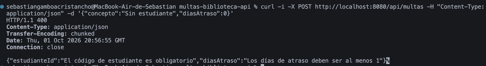

**4. Cuarta multa pendiente para el mismo estudiante — 409 Conflict**  
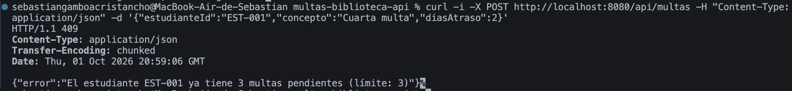

**5. ID inexistente — 404 Not Found**  
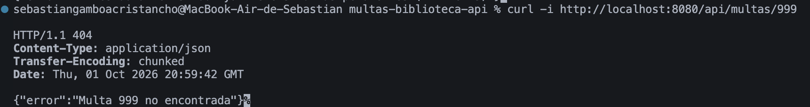

**6. Pago en ventanilla — 200 OK, estado PAGADA y método VENTANILLA**  
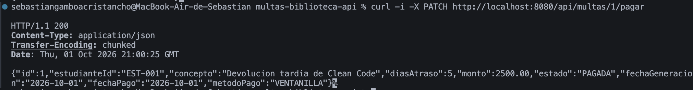

**7. Pago repetido de la misma multa — 409 Conflict**  
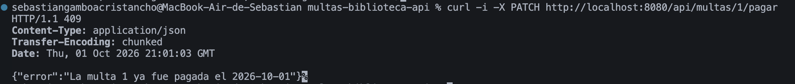

### Parte 2

**8. PagosUDES activo: pago aprobado — 200 OK, método PAGOSUDES**  
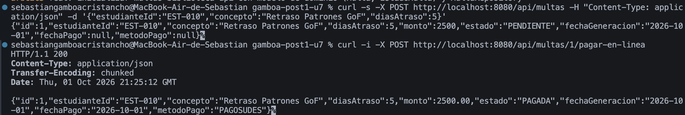

**9. PagosUDES activo: pago de $12.500 rechazado por la pasarela — 402 Payment Required**  
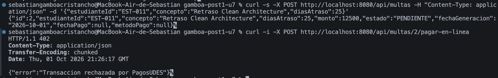

**10. Pago en línea de una multa ya pagada — 409 Conflict**  
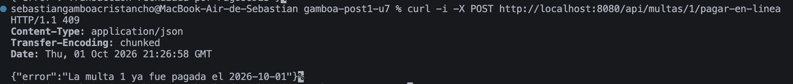

**11. Mismo JAR con `--app.pagos.proveedor=wompi`: pago aprobado — 200 OK, método WOMPI**  
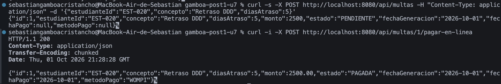

**12. Wompi activo: pago rechazado — 402 Payment Required**  
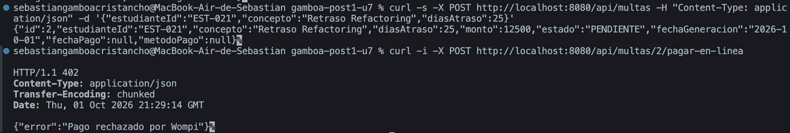

**13. Multa pagada en ventanilla y luego en línea — 409 Conflict**  
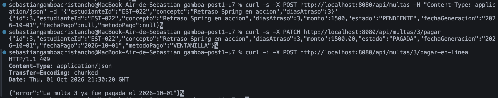

## Herramientas utilizadas

- Java 17 (nivel de compilación), Spring Boot 3.5, Spring Web, Spring Data JPA, Bean Validation, H2, RestTemplate
- Apache Maven, curl, Git, GitHub

## Decisiones de diseño

### Punto de decisión 1 — Cálculo del monto: ¿entidad o Service?

`Multa.calcularMonto` vive en la propia entidad. El criterio aplicado fue: **si una regla no necesita
ningún colaborador externo (Repository, otro Service, configuración), pertenece al objeto de dominio**.
El monto depende únicamente de los días de atraso, así que es una regla que describe cómo se comporta
una multa, no cómo se orquesta un caso de uso.

La alternativa —un método privado en `MultaService`— también funcionaría, pero dejaría a `Multa` como
un contenedor de datos sin comportamiento (modelo de dominio anémico). Cualquier otro punto del sistema
que necesite recalcular un monto, por ejemplo un proceso de reliquidación, tendría que duplicar la
fórmula o pasar por el Service para algo que no requiere dependencias. Además, en la entidad la regla
se prueba con JUnit puro, sin levantar el contexto de Spring. Lo mismo aplica a `marcarComoPagada`: la
entidad protege su propia invariante (no pagar dos veces) en lugar de confiar en que cada llamador la
verifique.

### Punto de decisión 2 — Conteo de multas pendientes: ¿consulta o filtrado en memoria?

El tope de 3 multas pendientes sí necesita datos que solo conoce la base de datos. La **decisión**
("¿se permite generar una multa más?") la toma `MultaService`, pero el **dato** ("¿cuántas tiene
pendientes?") se resuelve con `countByEstudianteIdAndEstado`, que Spring Data JPA traduce a un
`SELECT COUNT(*) ... WHERE estudiante_id = ? AND estado = ?`.

La alternativa —`findByEstudianteId` y filtrar con `stream().filter(...)`— traería a memoria todo el
historial del estudiante para quedarse con un número. Con pocos datos de prueba no hay diferencia
visible, pero con miles de multas por estudiante cada creación cargaría y mapearía miles de entidades:
el tiempo de respuesta y el consumo de memoria crecerían en proporción al historial, mientras que el
`COUNT` devuelve siempre una sola fila y puede apoyarse en un índice sobre `(estudiante_id, estado)`.

Limitación conocida: dos solicitudes simultáneas para el mismo estudiante podrían leer el mismo conteo
y superar el tope. Para este alcance se acepta; en producción se resolvería con un bloqueo pesimista o
una restricción en base de datos.

### Punto de decisión 3 — Selección del adaptador activo

Se eligió **`@ConditionalOnProperty` con un único bean activo**: según `app.pagos.proveedor`, Spring
crea solo `PagosUdesAdapter` o solo `WompiAdapter` al arrancar. Así `MultaService` recibe por
constructor un único `PasarelaPagoPort`, sin `@Qualifier`, sin `if` y sin conocer ninguna clave de
configuración. `PagosUdesAdapter` usa `matchIfMissing = true`, de modo que la aplicación siempre
arranca con una pasarela válida aunque la propiedad no exista.

La alternativa era inyectar un `Map<String, PasarelaPagoPort>` y elegir la clave en tiempo de
ejecución dentro de `MultaService`. Da más flexibilidad, porque permite cambiar de proveedor sin
reiniciar o incluso usar uno distinto por solicitud, pero se descartó por dos razones: el requisito
real es una pasarela **fija por sede** durante el piloto, y con el `Map` el servicio volvería a conocer
los nombres de los proveedores, que es justo lo que el puerto busca ocultar. El costo aceptado es que
cambiar de pasarela exige reiniciar la aplicación, como se ve en las capturas 8 y 11: el mismo JAR,
reiniciado con otra propiedad.

### Punto de decisión 4 — Diseño del puerto y el tipo de resultado

`PasarelaPagoPort.procesar` devuelve siempre un `ResultadoPago` con campos neutrales: `proveedor`,
`exitoso`, `referenciaExterna` y `mensaje`. Cada adaptador traduce su formato antes de devolverlo:
`PagosUdesAdapter` convierte `estadoTransaccion = "APROBADA"` en `exitoso = true`, y `WompiAdapter`
hace lo mismo con `status = "APPROVED"` después de enviar el monto en centavos.

Si el puerto devolviera el DTO propio de cada pasarela, o tuviera un método por proveedor,
`MultaService` tendría que conocer y distinguir ambos formatos, y agregar una tercera pasarela
obligaría a modificar el servicio además de crear un adaptador. Si `ResultadoPago` tuviera un campo
`idTransaccion` en lugar de `referenciaExterna`, `WompiAdapter` tendría que inventar un valor o guardar
su `reference` con un nombre que no describe lo que Wompi devuelve. Esa sería la señal de que el tipo
de dominio se diseñó a partir de PagosUDES y no era neutral respecto a los proveedores.

### Trade-off considerado — Parte 2

Se descartó extender las capas, sea con la Opción A (rama condicional) o con la B (Strategy en
`service/`), y se eligió el puerto con adaptadores (Opción C).

**Lo que se ganó:**

1. `MultaService` no conoce ningún formato HTTP: pesos frente a centavos y
   `idTransaccion`/`estadoTransaccion` frente a `reference`/`status` quedan encerrados en cada adaptador.
2. Agregar una tercera pasarela, o retirar una al terminar el piloto, consiste en crear o borrar un
   adaptador; no se toca ni el controlador ni el servicio.
3. El puerto se puede sustituir en pruebas por una implementación falsa sin levantar HTTP.

**Lo que costó:**

- Dos paquetes nuevos (`domain/` e `infrastructure/`) y seis archivos con unas 160 líneas, sin
  contar el simulador, frente a unas 30 que habría requerido la Opción A.
- Una indirección más que un integrante nuevo del equipo debe entender.
- Una pureza incompleta: el puerto recibe `Multa`, que es una entidad JPA, así que el dominio de pagos
  no está totalmente aislado de la persistencia. Separarlo exigiría un objeto de dominio propio y un
  mapeo adicional, que no se justificó para este alcance.
- La llamada a la pasarela ocurre dentro de la transacción de `pagarConPasarela`, que retiene la
  conexión a la base de datos mientras espera la respuesta HTTP; los *timeouts* de `RestTemplateConfig`
  acotan ese tiempo.

**¿Se revertiría la decisión?** Si el piloto terminara con una sola pasarela y sin planes de agregar
otra, el puerto pasaría a tener una única implementación y la Opción B sería suficiente. Aun así, el
equipo probablemente no lo revertiría de inmediato: deshacerlo costaría más que mantenerlo, y el
adaptador sigue aislando un contrato externo que puede cambiar por decisión del proveedor.

## Conclusiones

La Parte 1 mostró que una arquitectura en capas solo aporta valor si cada capa tiene una
responsabilidad real: el criterio de ubicar en la entidad las reglas sin dependencias, y en el
servicio las que necesitan datos, evitó tanto el modelo anémico como el servicio *passthrough*. La
Parte 2 mostró que hexagonal no es una arquitectura de todo o nada: bastó aplicarla a la frontera con
los sistemas externos, donde existía una variación real, y dejar el resto en capas. Lo más difícil fue
decidir entre las Opciones B y C, porque ambas resuelven la intercambiabilidad; la diferencia apareció
al considerar dónde vive la traducción de formatos y qué pasaría con una tercera pasarela. La
conclusión principal es que la decisión arquitectónica debe justificarse por fuerzas concretas del
requisito, no por preferencia de estilo.
